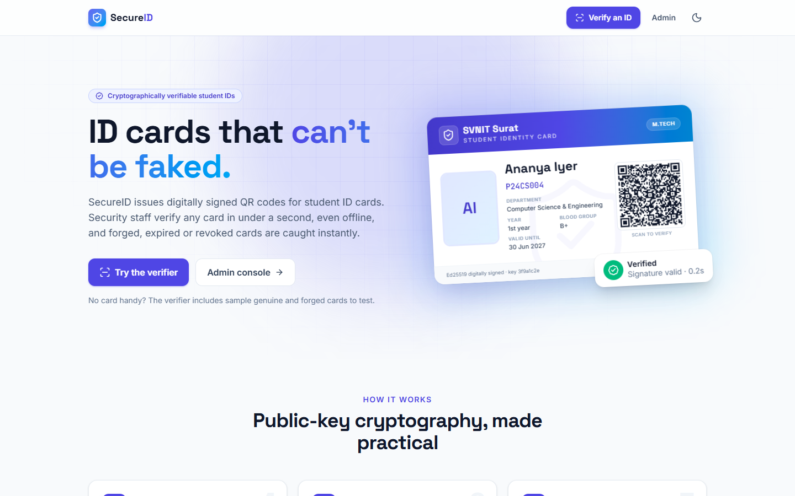
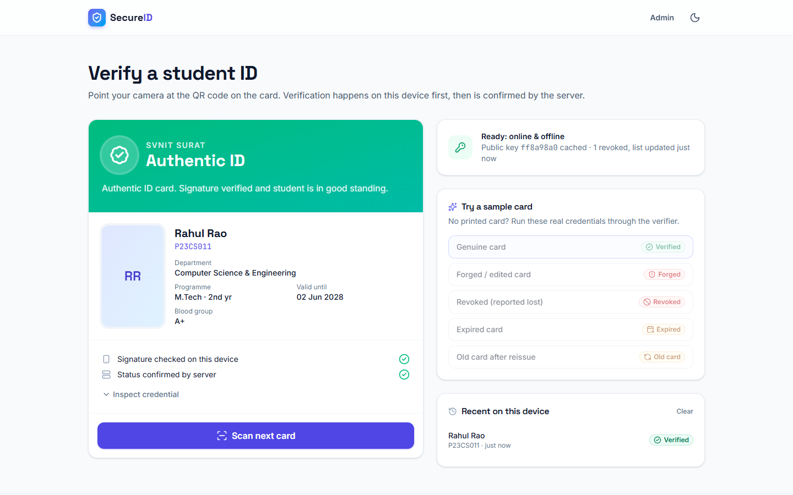
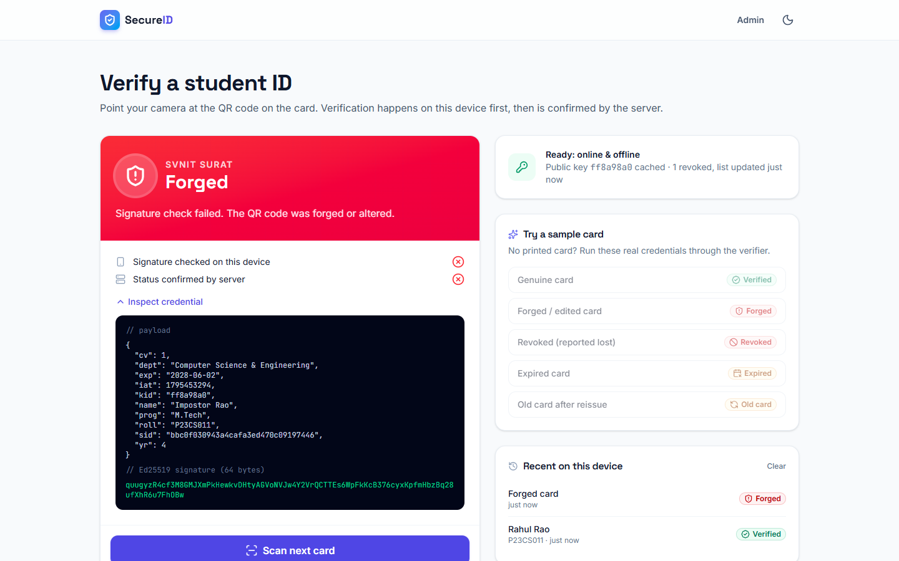
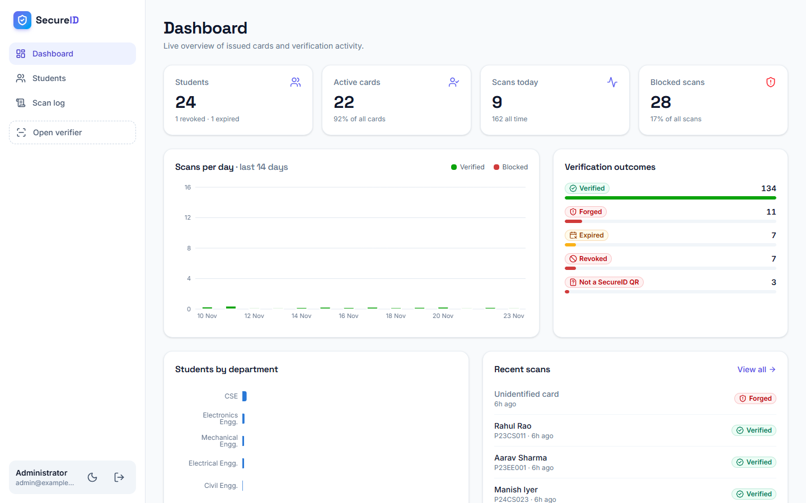
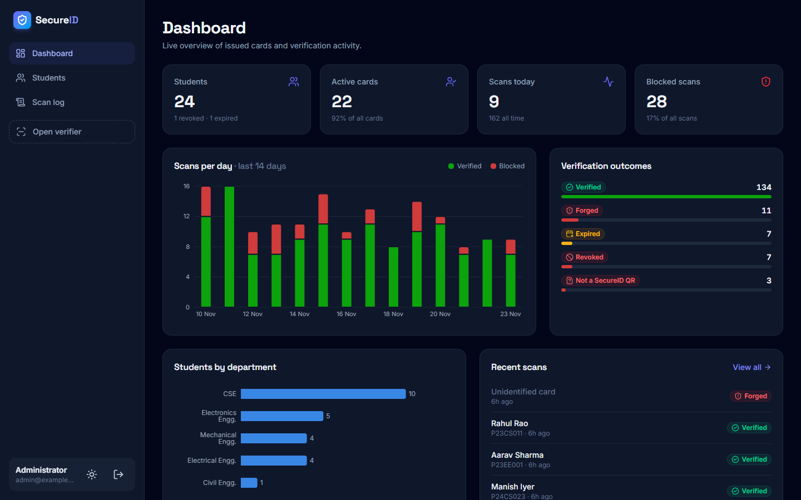
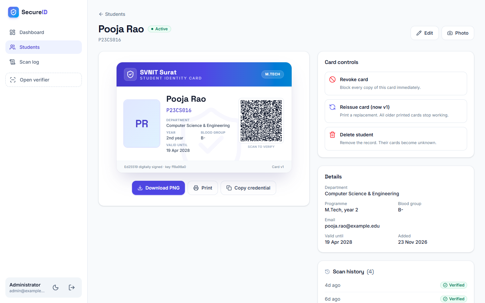
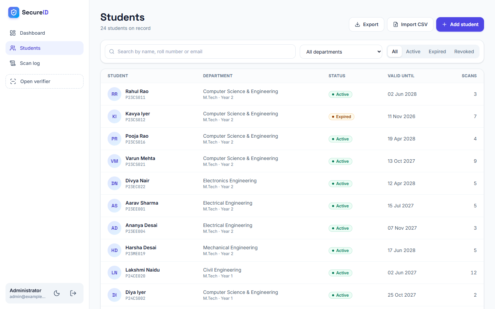
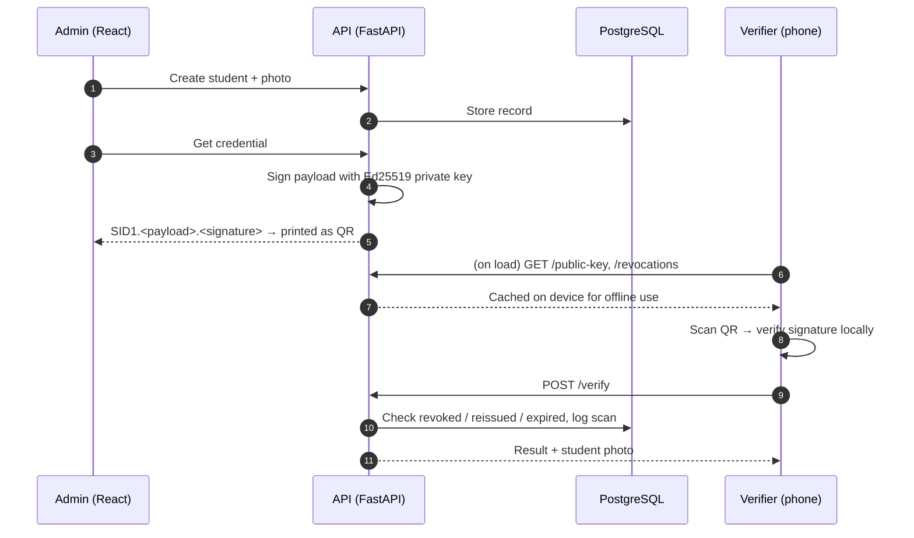

<div align="center">


# SecureID

**Tamper-proof student ID cards with digitally signed QR codes.**

Issue an ID card, print it, and let any phone verify it in under a second, even offline.
Forged, edited, expired, revoked and replaced cards are all caught.

[**Live demo**](https://student-qr-id.vercel.app) · [**API docs**](https://student-qr-id-api.onrender.com/docs) · [Report a bug](../../issues)




</div>

> **Try it:** open the [live demo](https://student-qr-id.vercel.app/verify) and tap a sample card, or open the
> [admin console](https://student-qr-id.vercel.app/login) (demo login is pre-filled).
> Hosted on free tiers: the first load after a quiet period can take ~30-50 s while the API wakes up.

---

## The problem

Printed student ID cards are trivial to fake. A photo editor and a colour printer are enough, and a security guard
has no way to tell a real card from a convincing copy. Plain QR codes don't help either, because anyone can
generate a QR code containing any text.

## The solution

SecureID puts a **digital signature** inside the QR code. The institution signs each student's details with a private
key that never leaves the server. Any scanner can check that signature using only the **public** key:

- if a single character of the card's data is changed, verification fails
- the public key cannot be used to create new cards, so a stolen scanner is harmless

On top of that, the server tracks revocations, card replacements and expiry, and logs every scan for audit.

---

## Features

| | |
|---|---|
| 🔏 **Ed25519 signatures** | Each credential carries a 64-byte signature over its exact bytes. Edits break it. |
| 📴 **Offline verification** | The verifier caches the public key and revocation list, so the gate keeps working without network. |
| ⚡ **Two-stage check** | The signature is checked on the device instantly, then the live status is confirmed by the server. |
| 🚫 **Instant revocation** | Lost card? One click and every scanner rejects it, with the reason shown. |
| 🔁 **Card reissue** | Issue a replacement; the old printed QR is automatically flagged as *superseded*. |
| 📅 **Expiry** | Cards carry a signed validity date and are rejected after it. |
| 🪪 **Printable ID cards** | CR80-size (85.6 × 54 mm) card design with photo, downloadable as PNG or printable directly. |
| 📊 **Admin dashboard** | Scans per day, blocked attempts, outcome breakdown and department stats. |
| 🧾 **Audit log** | Every verification attempt is recorded, including forged and unreadable codes. |
| 📥 **Bulk CSV import / export** | Onboard a whole batch from a spreadsheet; existing roll numbers are updated. |
| 📷 **Camera or image upload** | Scan with the phone camera (with torch and camera switching) or upload a photo of a QR. |
| 🧪 **Built-in sample cards** | Try genuine, forged, revoked, expired and replaced cards without printing anything. |
| 🌗 **Dark mode, mobile-first** | Responsive UI that works one-handed on a phone at the gate. |

---

## Screenshots

| Genuine card | Forged card (signature check fails) |
|---|---|
|  |  |

| Admin dashboard | Dark mode |
|---|---|
|  |  |

| ID card designer | Student directory |
|---|---|
|  |  |

---

## How it works



### What's inside the QR

```text
SID1.<base64url(payload)>.<base64url(signature)>
```

```jsonc
{
  "sid": "447e05ed…",            // student id
  "roll": "P23CE011",
  "name": "Rahul Verma",
  "dept": "Civil Engineering",
  "prog": "M.Tech", "yr": 2,
  "exp": "2027-08-05",          // expiry (signed)
  "cv": 1,                      // card version, bumped on reissue
  "kid": "ff8a98a0",            // which key signed it
  "iat": 1795452972             // issued at
}
```

The signature covers the **exact payload bytes**, so the verifier never re-serialises JSON. The whole credential is
about 330 characters, which keeps the QR small enough to scan quickly.

### Verification outcomes

| Result | Meaning |
|---|---|
| ✅ `valid` | Signature correct, student active, card current and not expired |
| 🛑 `tampered` | Signature check failed: the data was edited or the QR was forged |
| 🛑 `revoked` | The institution blocked this card (e.g. reported lost) |
| ⚠️ `superseded` | A newer card was issued; this is an old copy |
| ⚠️ `expired` | Past the signed validity date |
| ⚠️ `unknown` | Genuine signature, but the student record was deleted |
| 🛑 `malformed` | Not a SecureID QR code at all |

---

## Tech stack

| Layer | Choice | Why |
|---|---|---|
| Frontend | **React 19 + TypeScript + Vite** | Fast dev loop, typed API layer, code-split routes |
| Styling | **Tailwind CSS v4** | Consistent design tokens, dark mode |
| Data fetching | **TanStack Query** | Caching, background refresh, optimistic UX |
| QR | **qr-scanner** (WebWorker decoding), **qrcode** | Fast camera scanning on low-end phones |
| Client crypto | **@noble/ed25519** | Audited, dependency-free signature verification in the browser |
| Charts | **Recharts** | Dashboard visualisations |
| Backend | **FastAPI + SQLAlchemy 2** | Typed, async-ready, automatic OpenAPI docs at `/docs` |
| Server crypto | **cryptography** (Ed25519) | Industry-standard library |
| Auth | **JWT (PyJWT) + bcrypt** | Stateless admin sessions |
| Database | **PostgreSQL** (Neon) / SQLite locally | Free managed Postgres in production |
| Hosting | **Vercel** (frontend) + **Render** (API) | Both have free tiers |

---

## Run it locally

**Prerequisites:** Python 3.12+, Node.js 20+

```bash
git clone https://github.com/SAIGANESHABOTULA/student-QR-id.git
cd student-QR-id
```

**Backend** (http://127.0.0.1:8000, docs at `/docs`)

```bash
cd backend
python -m venv .venv
# Windows: .venv\Scripts\activate    macOS/Linux: source .venv/bin/activate
pip install -r requirements-dev.txt
cp .env.example .env               # SQLite + demo data by default
uvicorn app.main:app --reload --host 127.0.0.1
```

On first start it creates the database, the admin account from `.env`, 24 demo students and two weeks of sample
scans. If `SIGNING_KEY` is empty, a development key is generated in `backend/.keys/` (git-ignored).

**Frontend** (http://localhost:5173)

```bash
cd frontend
npm install
cp .env.example .env.local
npm run dev
```

Log in with `admin@example.com` / `admin12345` (from `backend/.env`).

**Tests**

```bash
cd backend && pytest -q          # 14 API tests: valid, forged, revoked, reissued, expired, CSV, photos…
cd frontend && npm run build     # type-check + production build
```

---

## Deploy for free

| Piece | Service | Free tier |
|---|---|---|
| Database | [Neon](https://neon.tech) | 0.5 GB Postgres |
| API | [Render](https://render.com) | 750 h/month web service (sleeps after 15 min idle) |
| Frontend | [Vercel](https://vercel.com) | Hobby plan |

1. **Database:** create a Neon project and copy the connection string (`postgresql://…`).
2. **Signing key:** run `python -m app.keygen` in `backend/` and keep the output secret.
3. **API on Render:** *New → Blueprint* → pick this repo (it reads [`render.yaml`](render.yaml)). Fill in
   `DATABASE_URL`, `SIGNING_KEY`, `ADMIN_EMAIL`, `ADMIN_PASSWORD`, and `CORS_ORIGINS` (your Vercel URL).
4. **Frontend on Vercel:** *Add New → Project* → this repo, **Root Directory = `frontend`**. Add the env var
   `VITE_API_URL=https://<your-render-service>.onrender.com`. For a public demo, also set `VITE_DEMO_LOGIN=true`,
   `VITE_DEMO_EMAIL` and `VITE_DEMO_PASSWORD` to pre-fill the admin login.
5. Open the Vercel URL. The first request after the API has been idle takes ~30-50 s while Render wakes it up.
   Signature checks keep working on the device during that time.

> **Never commit `SIGNING_KEY`.** Anyone holding it can mint valid cards. If it leaks, generate a new one;
> every card must then be reissued.

---

## API overview

| Method | Path | Auth | Purpose |
|---|---|---|---|
| `POST` | `/api/verify` | – | Verify a credential (rate-limited, logged) |
| `GET` | `/api/public-key` | – | Ed25519 public key for offline verification |
| `GET` | `/api/revocations` | – | Revoked IDs and current card versions |
| `GET` | `/api/demo-credentials` | – | Sample cards (only when `SEED_DEMO=true`) |
| `GET` | `/api/students/{id}/photo` | – | Student photo |
| `POST` | `/api/auth/login` | – | Admin login → JWT |
| `GET/POST` | `/api/students` | Admin | List (search, filter, paginate) / create |
| `GET/PATCH/DELETE` | `/api/students/{id}` | Admin | Read / update / delete |
| `POST` | `/api/students/{id}/photo` | Admin | Upload photo (auto-cropped to passport size) |
| `POST` | `/api/students/{id}/revoke` · `/reinstate` · `/reissue` | Admin | Card lifecycle |
| `GET` | `/api/students/{id}/credential` · `/qr.png` | Admin | Signed token / QR image |
| `POST` | `/api/students/import` · `GET /export.csv` | Admin | Bulk CSV |
| `GET` | `/api/stats` · `/api/scans` | Admin | Dashboard data and audit log |

Full interactive docs: `/docs` (Swagger UI).

---

## Project structure

```text
student-QR-id/
├── backend/
│   ├── app/
│   │   ├── main.py          # FastAPI app, CORS, startup
│   │   ├── signing.py       # Ed25519 sign / verify, token format
│   │   ├── services.py      # verification rules, photo processing, demo cards
│   │   ├── models.py        # Admin, Student, ScanLog
│   │   ├── routers/         # auth, public, students, stats
│   │   └── seed.py          # admin bootstrap + demo data
│   └── tests/test_api.py
├── frontend/
│   └── src/
│       ├── lib/credential.ts   # on-device verification + offline cache
│       ├── components/         # IdCard, Scanner, layouts, UI kit
│       └── pages/              # Landing, Verify, Login, admin/*
├── render.yaml                 # Render blueprint
└── .github/workflows/ci.yml    # tests + build on every push
```

---

## Improvements over the original version

This is a rebuild of my M.Tech project, which was a Node/Express API with a static HTML scanner page.

| Original | SecureID |
|---|---|
| RSA-PSS 2048 signature (344 chars), dense QR | Ed25519 (86 chars), smaller and faster to scan |
| Signature over `JSON.stringify(data)`, so it breaks if key order changes | Signature over exact payload bytes |
| Private key committed to the repository | Key from environment variable, never in git |
| Verification only online | On-device verification with offline fallback |
| Valid / invalid only | Revocation, reissue, expiry, unknown-student states |
| Photos bundled in the frontend by roll number | Photos uploaded, cropped and served by the API |
| No admin UI, no data store | Full admin console, PostgreSQL, audit log, CSV import |
| No tests | API test suite + CI |

---

## Author

**Sai Ganesh Abotula** · M.Tech · [GitHub](https://github.com/SAIGANESHABOTULA)

If you found this useful, consider giving the repo a ⭐.
